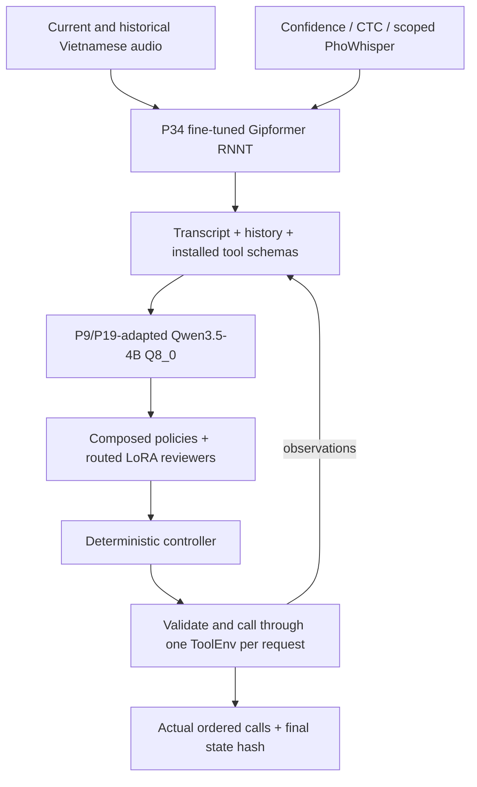

# LifeMate 2026 — Vietnamese Speech-to-Tool Agent

LifeMate turns Vietnamese speech and conversation history into sequential tool
calls. It combines fine-tuned speech recognition, a small adapted language model,
and a deterministic execution controller that feeds tool observations back into
planning. Built for the Zalo AI Challenge 2026, it explores a difficult engineering
problem: translating noisy speech into the correct **state changes**, within an
offline inference budget.

This repository provides a runnable CPU demonstration, an installable core, and
the preserved source of the submitted **K48.46 RC2** system. The developer core is
an import-adapted extraction of real RC2 components; the complete submitted policy
chain remains frozen in `archive/rc2/`. Model weights and organizer data are absent.
The final official Private Test score was **19.6 (user-reported)**.

## System architecture



See the [execution path](docs/ARCHITECTURE.md) and
[source map](docs/SOURCE_MAP.md) for the entrypoint, ASR sidecars, reviewer routing,
and mounted SDK integration.

## Implemented capabilities

- **Vietnamese ASR adaptation:** P34 fine-tunes Gipformer with RNNT and CTC losses;
  epoch-2 ONNX inference is supplemented by scoped acoustic corroboration.
- **Small-model adaptation:** sequential P9/P19 LoRA training of Qwen3.5-4B,
  including gated real-ASR variants, followed by merge and GGUF conversion.
- **Structured decisions:** JSON-constrained tool proposals, observed-ID grounding,
  schema checks, and explicit finish decisions.
- **Stateful execution:** validation before dispatch, actual call logs, deadline
  checks, and one caller-owned environment per request. History is context;
  previous tool effects are not replayed.
- **Review and deployment:** Q8_0 serving through llama.cpp, dynamically selected
  write/terminal adapters, offline Docker transport and CLI/notebook entrypoints.
- **Execution-grounded evaluation:** local state-gated tool-call F1, trace analysis,
  and preserved release parity checks with clearly stated limits.

## Technical approach

The system predicts one action at a time, then observes its result. This allows
later arguments to use returned identifiers and makes failed calls visible to
the planner. Deterministic control flow constrains execution; it does not make
model decisions semantically correct.

RC2 uses an **8,192-token context**, a **seven-decision budget**, and a **30-second
request deadline**. Two LoRA reviewers share the decision backbone. The write
reviewer uses DPO; the terminal reviewer uses SFT plus a reference-anchored
first-token preference loss, not full-sequence DPO. Training implementations and
restoration requirements are mapped in [training/](training/README.md).

## Repository structure

```text
src/lifemate/       Installable ASR, planner, agent, controller and local metrics
training/          Training implementation map and restoration requirements
configs/           RC2 parameter reference and exact source mapping
examples/          Explicitly synthetic, in-memory demonstration
scripts/           Source export, integrity and publication checks
tests/             CPU tests of core behavior and frozen transport
.github/workflows/ Python 3.11/3.12 lint, tests, checks and wheel smoke test
docs/              Architecture, setup, evaluation, results and engineering notes
archive/           Unchanged RC2 source, historical recipes and evidence
```

Start with [asr.py](src/lifemate/asr.py),
[llm_planner.py](src/lifemate/llm_planner.py),
[agent.py](src/lifemate/agent.py) and [controller.py](src/lifemate/controller.py).
The final composed agent is
[FinishSourceOrderAgent](archive/rc2/overlay/runtime/lifemate/experiments/continuous_improvement/finish_consistent_review_e2e_v1/agent.py),
selected by the frozen [RC2 transport](archive/rc2/overlay/predict.py).

## Getting started

Python **3.11 or 3.12**, Git and a Linux-compatible environment are sufficient for
the lightweight workflow. The core has no third-party runtime dependencies.

```bash
git clone https://github.com/VThuong99/zac26-lifemate.git
cd zac26-lifemate
python3 -m venv .venv
source .venv/bin/activate
python -m pip install -e '.[dev]'
lifemate-demo
```

The demo sends scripted JSON through the real base planner, parser, agent and
controller: list a synthetic light, use its observed ID, turn it on, then finish.
Its output explicitly reports mock execution. **It performs no ASR, LLM inference,
official SDK execution, or external side effects.** Its hash is a mock state hash.

[Development](docs/DEVELOPMENT.md) covers extension points and package scope.
[Real inference](docs/INFERENCE.md) requires separately authorized checkpoints,
native binaries, the matching organizer SDK/data, and the preserved environment.
A fresh clone is not a complete inference or training distribution.

## Testing and evaluation

```bash
python -m unittest discover -s tests -v
python scripts/test_archived_helpers.py
python -m ruff check src tests scripts examples
python scripts/verify_source_layout.py
python scripts/verify_archive.py
python scripts/check_repository.py
```

Tests use synthetic fixtures and mocked boundaries. They cover action validation,
observation feedback, no replay of history, deadline handling, strict JSON,
state-gated metrics, ASR input boundaries and RC2 partial-output failure behavior.
Source checks verify that the extracted modules differ only in imports and that
the archive still matches its manifest. CI also builds and tests an isolated wheel.
See [evaluation methodology](docs/EVALUATION.md) for what these checks establish.

## Competition results

| System | Split | Score | Provenance |
|---|---|---:|---|
| Frozen P19 baseline | Official Public | **40.63** | User-reported official result; historical project records |
| P34 ASR update | Public | **44.69** | Reported result; historical project records |
| Final K48.46 RC2 | Official Private | **19.6** | User-reported on November 21, 2026 |

No independent portal receipt was available. The final Private Test JSONL used a
**diagnostic continuation workaround**, as reported by the user. The original
Docker batch could terminate when a prompt exceeded its 8,192-token context;
continuation changed batch error handling. A completed host continuation receipt
was unavailable for independent verification. These results do not establish a
causal benefit for individual components. [Full provenance and failure analysis](docs/FINAL_RESULTS.md).

## Limitations and lessons learned

The final Private result was disappointing. Local improvements on repeatedly
inspected development cohorts did not establish generalization. Valid JSON,
reviewer agreement and successful tool calls did not guarantee correct intent.
The context-overflow incident exposed missing headroom and request-level failure
isolation. Full retraining, a fresh-clone GPU run, and actual A30 execution remain
unverified. The implementation is a competition engineering project, not a
production-ready assistant. [Lessons learned](docs/LESSONS_LEARNED.md).

## References and acknowledgments

The project builds on Qwen, Gipformer/Icefall, PhoWhisper, Sherpa ONNX,
llama.cpp, and the organizer's ToolEnv interface. Pinned revisions, upstream
references and notices are retained in the
[training record](archive/rc2/overlay/training_code/README.md),
[model manifest](archive/rc2/overlay/manifests/models.json) and
[third-party notices](archive/rc2/overlay/licenses/).

Public source visibility does not grant a blanket open-source license. No new
LICENSE is asserted. Organizer data, weights, image archives and original
research-history blobs remain excluded. See [publication boundaries](docs/PUBLIC_RELEASE_AUDIT.md)
and the [archival handover](docs/ARCHIVAL_HANDOVER.md) for detailed records.
