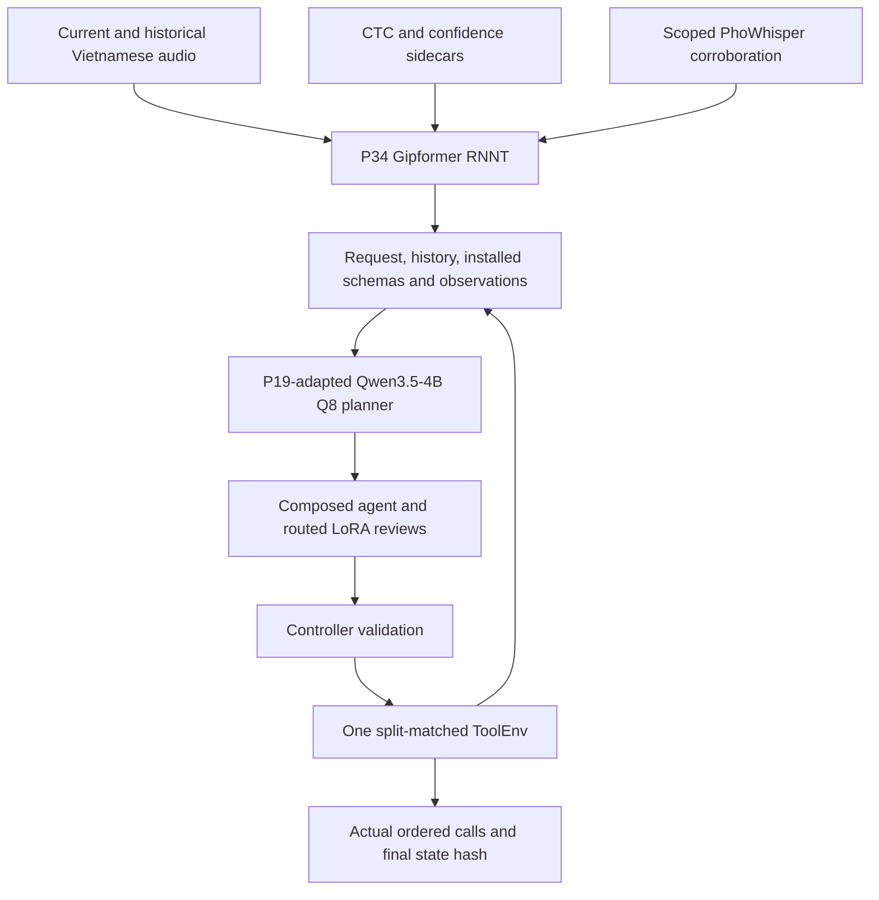

# System architecture

For a file-by-file reading path, start with the [source map](SOURCE_MAP.md).
The installable [core](../src/lifemate/) exposes the original ASR/planner/controller
components with import-only relocation. Its [mock demo](../examples/README.md)
exercises the base loop. The submitted K system additionally composes the
policies, acoustic sidecars and reviewers described below; it continues to use
the unchanged archived modules. See [development](DEVELOPMENT.md) and
[real inference](INFERENCE.md) for the two environments.

This document describes the frozen November 16 RC2 implementation. Archived
RC1/P34 documents retain their historical claims; the
[RC2 addendum](../archive/rc2/overlay/FINAL_CANDIDATE.md), source and later release
receipts identify the final package. No inference behavior changed for archival.

## Speech pipeline

The primary recognizer is Gipformer1.5-68M RNNT, fine-tuned as P34 and exported
at epoch 2 to encoder/decoder/joiner ONNX plus the original tokens. Sherpa greedy
CPU decoding uses four threads. Current and historical user audio are transcribed;
previous assistant observations remain context, and historical tool effects are
not replayed.

K adds an independent ONNX confidence recognizer, a P34 PyTorch CTC sidecar and
PhoWhisper-medium on CUDA for scoped corroboration, including ambiguous digits.
The CTC sidecar needs the original `epoch-2.pt` at **inference**; it must not be
discarded as a training-only checkpoint. Shared CTC reuses that loaded model.
PhoWhisper uses the pinned publisher weights, Vietnamese transcription, FP16,
one beam and `max_length=224`. Agreement is evidence, not proof of spoken intent.

The conservative historical parameter bound is **5,670,135,589**, counting three
P34-sized instances, 4,659,865,088 source-architecture LLM parameters,
763,857,920 PhoWhisper parameters and both full F32 adapter file sizes / 4.
This corrects the earlier two-copy bound in the preserved submission report.
It is a conservative accounting convention, not an organizer-approved census.
Model paths, sizes, revisions and hashes are in
[models.json](../archive/rc2/overlay/manifests/models.json).

## Planner, reviewers and controller

The decision model is Qwen3.5-4B with merged P9 and P19 LoRA adaptations,
converted to Q8_0 GGUF. The historical tokenizer/template and local llama.cpp
backend are preserved. Serving uses 8,192 context, deterministic strict JSON,
temperature 0, seed `20261030`, no thinking, no prompt cache and a seven-decision
budget. Tool results feed the next decision rather than a precomputed full plan.

The actual entry chain starts in
[predict.py](../archive/rc2/overlay/predict.py), imports
`conditional_terminal_pref_flight_e2e_v1/worker.py`, and selects arm C with
`FinishSourceOrderAgent`. That chain retains the temporal, reference, recipient,
schema-feedback, condition and finish policies. The old minimal Agent alone
does not describe K.

Two adapters are loaded at scale zero and selected per request to the local
model server: adapter 0 for ordinary write review; adapter 1 for the finish-source
review path. These share the decision backbone; they are not two additional LLMs.
The K terminal objective uses shared SFT plus a reference-anchored first-token
preference term, **not full-sequence DPO**. Research safety-preflight interception
is explicitly forbidden in the submitted entrypoint; gated development results
must not be presented as unrestricted RC2 behavior.

The frozen controller calls `env.validate(name, arguments)` and, when accepted,
`env.call(name, arguments)`. It does not create/reset environments. The transport
selects the mounted split's SDK, enforces one constructor per request and returns
the environment's actual calls and final hash. Rejected proposals are distinct
from executed calls. No reference transcripts, labels or hidden environment
state are supplied to the planner.

## Historical training recipes

These are historical recipes, not a claim of clean-machine training reproduction.
The [training map](../training/README.md) links each implementation and provides
a checked public-source export into an isolated study workspace.
Exact implementations/configurations are retained under
[training_code](../archive/rc2/overlay/training_code/README.md), including its
`historical/`, `p19_generation_snapshot/` and `restored/lifemate/` trees.

| Component | Recorded construction |
|---|---|
| P9 decision adaptation | Qwen revision `851bf6e806efd8d0a36b00ddf55e13ccb7b8cd0a`; BF16 LoRA rank/alpha 16, learning rate 1e-4, seed 20261030; merge before P19. |
| P19 real-ASR adaptation | Rank/alpha 16, learning rate 1e-5, one epoch, microbatch 1, accumulation 16, seed 20261031; 1,198 original decisions plus 373 gated ASR variants. Configured pool: 374 roots, 120 eligible. Pool membership is not proof every example reached the deployed checkpoint. |
| P34 ASR | Gipformer revision `dd9227dcd8705c13f33bdbe59728d546ab94480f`; 2,475 train / 282 dev clips; two FP32 epochs, AdamW 1e-5, batch 1, weight decay 0, clipping 5, seed 20261103. Loss: .75 simple RNNT + .55 pruned RNNT + .2 CTC; prune range 5. Epoch 2 selected by dev WER. |
| Write reviewer | P20c P19-initialized BF16 DPO, rank/alpha 16, learning rate 5e-6, beta .1, one epoch, accumulation 16, seed 20261101; grammar-conditioned reviewed preference pairs. |
| K terminal reviewer | Rank/alpha 4; q/v/gate/up/down projections; 124 SFT presentations, 16 optimizer steps, batch 1, accumulation 8, learning rate 4e-5, seed 2026110813; preference weight .1, beta 1, three frozen pairs. |

Training data, masks, base checkpoints and some preparation dependencies remain
outside this source archive. The recovered 65-file layout passed historical
syntax/direct-import checks, not complete retraining. Some scripts have absolute
historical paths and import-time work; inspect them without executing discovery
imports. Reconstruct an isolated workspace before any future authorized training.

## Deployment and failure boundaries

The RC2 image adds its overlay to an existing base image and flattens the result.
Its source, dependency, model and native manifests are retained. The underlying
release uses CUDA 13.2 / Ubuntu 24.04 with Python 3.12 and preserved CUDA 13.1
backend libraries. Exact dependency manifests do not make mutable apt mirrors
or missing private inputs reproducible indefinitely.

RC2 preserves the original `sm120` backend for capability 12.0 and selects its
existing dual-target native build for capability 8.0. Actual A30 execution was
not verified; older RC1 statements that Ampere always fails are historical.
The mounted SDK replaces any packaged organizer SDK. The NVIDIA entrypoint is
preserved; CLI uses `/bin/bash /code/predict.sh`; notebook calls the same
`KRuntime` and writes `jupyter_submission.jsonl`.

Timing starts before audio I/O and includes ASR, reviews, tool calls and final
hash collection. Model loading is reported separately. The parent enforces the
30-second deadline and kills a timed-out worker. It writes a result receipt
before raising a recorded inference error when such a receipt exists.
`write_predictions` flushes successful rows to `.partial` and renames only after
the whole batch completes. There is no request-level catch in that submitted
batch loop. See [failure analysis](FINAL_RESULTS.md) and
[lessons](LESSONS_LEARNED.md).
